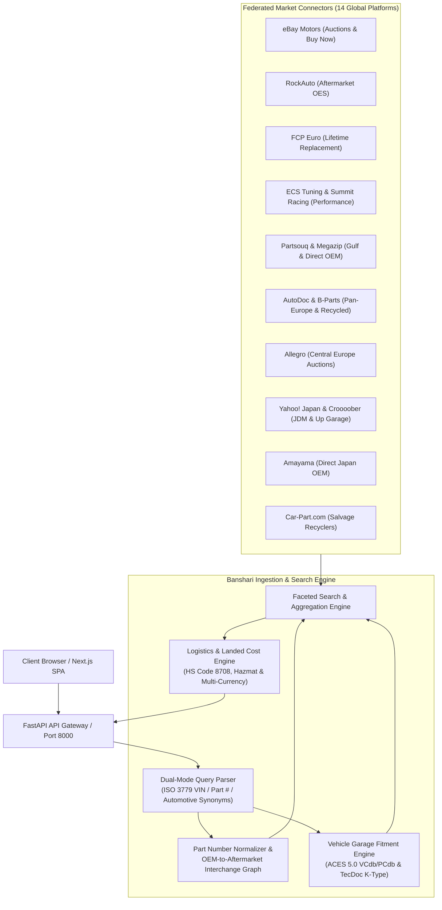

# Banshari (منشاري) — Global Automotive Spare Parts Metasearch Engine & Landed Cost Aggregator

  

**Banshari** is a production-grade, federated automotive spare parts metasearch engine and international landed-cost aggregator. It aggregates listings in real time across global retailers, salvage networks, and auction houses (eBay Motors, RockAuto, Partsouq, AutoDoc, Yahoo! Auctions Japan / Buyee, and Car-Part.com), normalizing fitment against international automotive catalog standards and computing CIF landed costs (Customs Duty + Import VAT/GST + Air/Ocean Freight) for any destination country worldwide.

---

## 1. System Architecture & Standards Compliance



### Automotive Industry Standards:
- **ACES 5.0 (Aftermarket Catalog Exchange Standard):** Models vehicle fitments using `VCdb` (BaseVehicleID, Make, Model, Year, EngineBaseID) and `PCdb` (PartTerminologyID, Mounting Position).
- **PIES 8.0 (Product Information Exchange Standard):** Stores dimensional weight (L×W×H in cm), weight (kg), materials, country of origin, warranty duration, and hazardous materials classification.
- **TecDoc (K-Type / N-Type):** Provides compatibility mapping for European and Asian catalog specifications (Generic Article ID, K-Type passenger vehicle ID).
- **Part Number Normalization & Interchange Graph:** Cleans all OEM numbers (stripping hyphens, slashes, spaces) and indexes bidirectional equivalences between OEM and aftermarket brands (e.g., BMW `34-11-6-792-223` ⇄ Brembo `09.C399.13` ⇄ Zimmermann `150.3483.20`).
- **ISO 3779 VIN Resolution:** Decodes 17-character VINs by World Manufacturer Identifier (WMI), Vehicle Descriptor Section (VDS), and Model Year Character (VIS).
- **HS Code 8708 Tariff Classification & Hazmat Detection:** Maps categories to Harmonized System Chapter 8708 (e.g. `8708.30.00` for brakes, `8708.80.00` for suspension) and flags IATA restricted goods (Class 1.4G pyrotechnic airbags, Class 2.2 pressurized gas shocks, Class 9 lithium batteries).

---

## 2. Unified Part Listing JSON Schema

Each normalized part listing across all sources conforms to the following schema:

```json
{
  "id": "ps-bmw-34116792223",
  "source_platform": "Partsouq",
  "source_listing_id": "PS-7889102",
  "source_url": "https://partsouq.com/en/search/all?q=34116792223",
  "title": "BMW Genuine Front Brake Disc Rotor 340x30mm (OEM)",
  "brand": "BMW Genuine",
  "manufacturer_part_number": "34-11-6-792-223",
  "clean_part_number": "34116792223",
  "interchange_part_numbers": ["09C39913", "150348320", "55523", "DF6603S"],
  "primary_image_url": "https://images.unsplash.com/photo-1600790142055-619df03207e6?w=600&h=450&fit=crop",
  "part_type": "Brake Rotor",
  "aces_fitments": [
    {
      "base_vehicle_id": 141029,
      "make_name": "BMW",
      "model_name": "330i",
      "year_start": 2016,
      "year_end": 2024,
      "engine_description": "2.0L L4 Turbo B48",
      "pcdb_part_terminology_id": 1896,
      "pcdb_position": "Front Axle Both Sides"
    }
  ],
  "tecdoc_fitments": [
    {
      "k_type": 119421,
      "generic_article_id": 82,
      "article_number": "34116792223"
    }
  ],
  "pies_attributes": {
    "weight_kg": 9.8,
    "dimensions_cm": { "length": 34.0, "width": 34.0, "height": 7.3 },
    "material": "High Carbon Cast Iron",
    "country_of_origin": "DE",
    "warranty_months": 24
  },
  "listing_type": "buy_now",
  "condition": "new_factory_sealed",
  "authenticity_tier": "oem_genuine",
  "currency": "USD",
  "buy_now_price": 178.50,
  "seller_name": "Partsouq Direct Middle East",
  "seller_rating": 4.9,
  "seller_country": "AE",
  "shipping": {
    "hs_code": "8708.30.00",
    "hazmat_class": "none",
    "air_freight_restricted": false,
    "ships_to": ["US", "SA", "AE", "GB", "DE", "KW", "QA"],
    "ships_worldwide": true,
    "base_shipping_cost_usd": 38.00
  }
}
```

---

## 3. Docker & Self-Hosting Deployment Guide

Banshari includes a multi-arch container image (`ARM64` and `x86_64`) ready to run on any Linux server, home server, or cloud host.

### Step 1: Clone the Repository
```bash
git clone https://github.com/iHosam/Banshari.git
cd Banshari
```

### Step 2: Run with Docker Compose
```bash
docker compose up -d --build
```

### Step 3: Access the Application
Open your browser and navigate to:
```
http://<your-server-ip>:8000
```
or locally:
```
http://localhost:8000
```

---

## 4. Local Execution & Testing

To run directly with Python:
```bash
git clone https://github.com/iHosam/Banshari.git
cd Banshari
pip install -r requirements.txt
python run.py
```
Open [http://localhost:8000](http://localhost:8000) to view the live dashboard.

To run the automated test suite:
```powershell
python -m unittest tests/test_engine.py
```
All 8 test cases verify:
- OEM Part number normalization and punctuation stripping
- Bidirectional interchange graph linking
- ISO 3779 17-digit VIN decoding
- Cross-Atlantic automotive synonym expansion (e.g. rotor ⇄ disc, wing ⇄ fender)
- CIF Landed Cost and customs duty/VAT calculations
- Faceted filtering (Auctions vs Buy Now, Condition, OEM vs Aftermarket)
- IATA Hazmat air freight restriction detection
